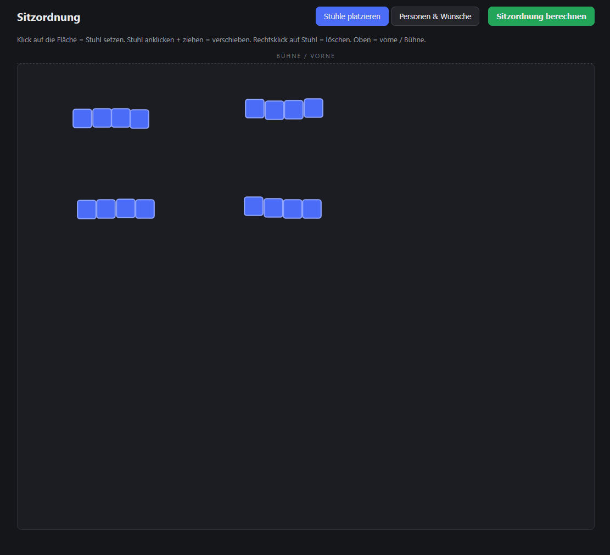
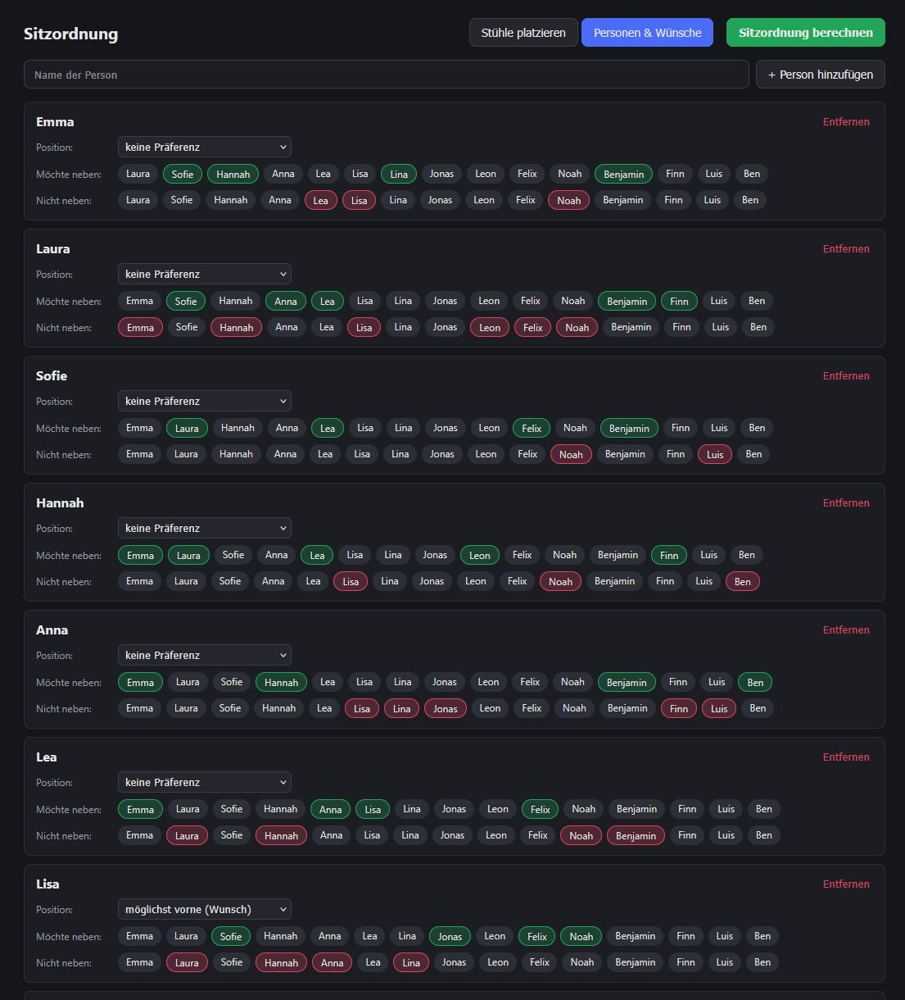
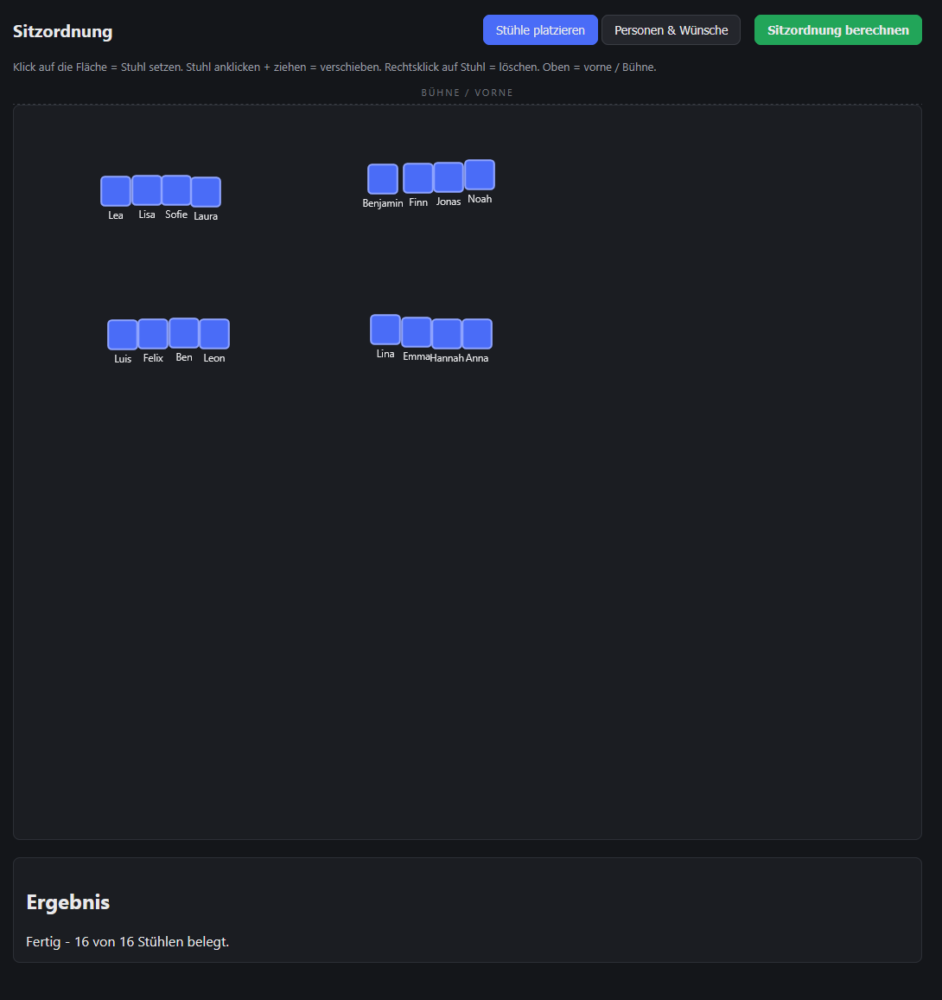
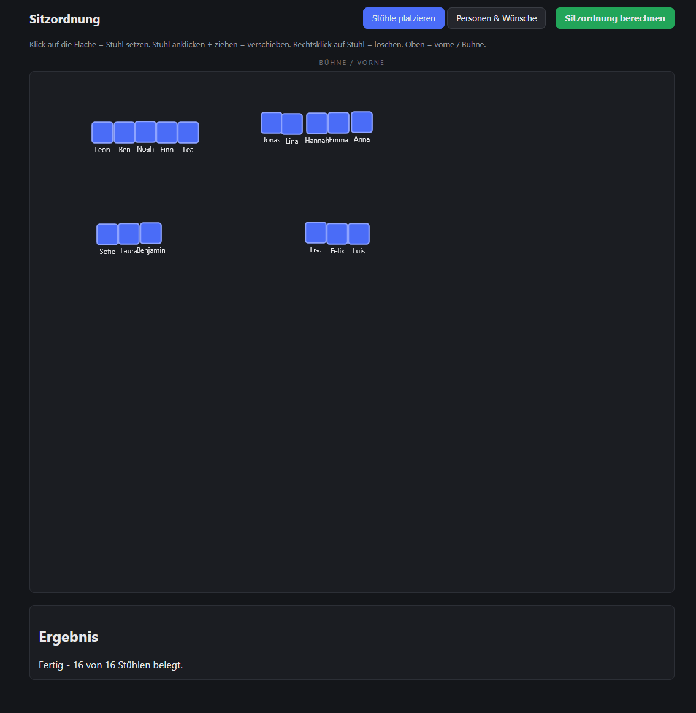

# Sitzordnung

## Lokal starten

```bash
python -m venv venv
source venv/bin/activate      # Windows: venv\Scripts\activate
pip install -r requirements.txt
uvicorn backend.main:app --reload --port 8000
```

Dann im Browser: http://localhost:8000

Die interaktive API-Doku (automatisch von FastAPI generiert, gut zum
Ausprobieren einzelner Requests): http://localhost:8000/docs

## Render Link für Browser

Hier ist der Services erreichbar: https://stuhlordnung.onrender.com/
Der Services braucht ein bisschen zum starten(Wartezeiten von 30-50 Sekunden sind normal).


## Installer

Der Installer befindet sich im Repo und kann dort einfach gedownloaded werden,  da das ganze
nur für den privaten Gebrauch geplant ist habe ich keinen Release 
dafür erstellt, trotzdem kann es natürlich jeder hier downloaden und verwenden.


## Projektstruktur

```
backend/
  algorithm.py   - Zuteilungslogik (Simulated Annealing), unabhängig vom Web
  models.py      - definiert das JSON-Format der API
  main.py        - FastAPI-Server: Endpunkt /api/assign + liefert Frontend aus
frontend/
  index.html     - Grundgerüst
  style.css      - Styling
  app.js         - Canvas-Interaktion, Personenverwaltung, ruft /api/assign auf
render.yaml      - Config für Render
run_desktop-py   - Startet das Programm für Desktop
```

## Lizenz
[](LICENSE.txt)

```
Sitzordnung - An Interactive Seating Arrangement Tool
Copyright (C) 2026 Relaxonaut

This program is free software: you can redistribute it and/or modify
it under the terms of the GNU General Public License as published by
the Free Software Foundation, either version 3 of the License, or
(at your option) any later version.

This program is distributed in the hope that it will be useful,
but WITHOUT ANY WARRANTY; without even the implied warranty of
MERCHANTABILITY or FITNESS FOR A PARTICULAR PURPOSE. See the
GNU General Public License for more details.

You should have received a copy of the GNU General Public License
along with this program. If not, see <https://www.gnu.org/licenses/gpl-3.0.txt>.
```

## Anleitung

### Plazieren, Verschieben und Löschen

In diesem User interface können Sie beliebig Tische plazieren, verschieben und löschen.



Das Plazieren erfolgt über die linke Maustaste und das Löschen über die rechte Maustaste.
Wie sie oben im Interface sehen, verfügt der Canvas über eine Richtung, Oben ist vorne.

### Personen und Wünsche

Dieses interface erreichen Sie in dem sie auf den Button "Personen und Wünsche" klicken.
In diesem Interface lassen sich Namen hinzufügen und entfernen. 
Wenn Sie alle Namen hinzugefügt haben, können Sie die entsprechenden Personen durch
anklicken auswählen. 



Es lassen sich außerdem Positionswünsche mit unterschiedlicher Priorität hinzufügen. 
Leider bisher begrenzt auf "möchte vorne sitzen" und "muss vorne sitzen". 


### Sitzornungsberechnung

Durch das klicken auf "Sitzordnung berechnen" rechnet der Server die bestmögliche Sitzordnung aus.



#### Wichtig: Das muss nicht die fairste sein. Der Server geht nach einem Score, welcher nicht berücksichtig, ob einzelne übergangen wurden.

Die Berechnung kann mehrfach ausgeführt werden und erzeugt so in den meisten fällen eine gleichwertige Option.
Außerdem lassen sich die Tische aus nach der Berechnung verschieben, wodurch manuele Änderungen möglich sind.

So kann zum Beispiel aus dem vorherigen Bild, das hier werden: 



Im unteren Teil sehen Sie außerdem die Anzahl der belegten Plätze.


## Datenschutzerklärung
#### *Hinweis: Da dieses Projekt öffentlich im Internet erreichbar ist, bin ich gesetzlich dazu verpflichtet, eine Datenschutzerklärung bereitzustellen.*

### 1. Verantwortlicher für die Datenverarbeitung
E-Mail: [Relaxonaut.Web@proton.me]

### 2. Bereitstellung der Website und Server-Logfiles
Unsere Website wird beim Cloud-Hosting-Anbieter Render (Render Services, Inc.) gehostet. 
Bei jedem Aufruf der Webseite erfasst der Hoster automatisch technische Daten (Server-Logfiles), wie z. B. deine IP-Adresse, Browsertyp und den Zeitpunkt des Aufrufs. Dies ist technisch notwendig, um die Stabilität und Sicherheit der Webseite zu gewährleisten.
* Rechtsgrundlage: Art. 6 Abs. 1 lit. f DSGVO (Berechtigtes Interesse am sicheren Betrieb der Webseite).
* Hinweis zur Auftragsverarbeitung: Wir haben mit dem Anbieter Render ein Data Processing Agreement (DPA) abgeschlossen, um den Schutz deiner Daten im Einklang mit der DSGVO sicherzustellen.

### 3. Verarbeitung von Eingabedaten (Sitzordnung)
Im Sinne der Datensparsamkeit werden alle von dir eingegebenen Daten (Namen, Sitzwünsche, Koordinaten) ausschließlich im flüchtigen Arbeitsspeicher (RAM) des Servers verarbeitet. 
Es findet keine dauerhafte Speicherung in Datenbanken, kein Tracking und keine Profilbildung statt. Sobald du das Browserfenster schließt, werden diese Daten unwiderruflich gelöscht.
* Rechtsgrundlage: Art. 6 Abs. 1 lit. b DSGVO (Durchführung eines vorvertraglichen/vertraglichen Nutzungsverhältnisses).

### 4. Deine Rechte
Dir stehen als betroffene Person grundsätzlich die Rechte auf Auskunft, Berichtigung, Löschung und Einschränkung der Verarbeitung zu. Da wir keine Daten dauerhaft speichern, können wir nach Beendigung deiner Sitzung keine Auskunft über vergangene Eingaben geben. 
Du hast zudem das Recht, dich bei einer Datenschutz-Aufsichtsbehörde zu beschweren.

## Bugs and Fixes

### Bekanntes Problem: Firefox

Im Firefox sind Mausklicks auf der Stuhl-Fläche vertikal verschoben (in der Mitte
korrekt, zum oberen/unteren Rand hin zunehmend). In Edge/Chromium tritt das nicht auf.
Daher wird Firefox aktuell nicht unterstützt.

Bereits versucht:

- Canvas-Höhe von `height: 65vh` auf `aspect-ratio: 1000 / 700` umgestellt,
  damit keine leeren Streifen um die Zeichenfläche entstehen
- Koordinatenumrechnung (`svgPoint`) ohne `getScreenCTM()` neu geschrieben:
  manuelle Berechnung über `getBoundingClientRect()` und die `viewBox`-Skalierung
- Drag & Drop von Maus-Events auf Pointer-Events umgestellt, mit einmalig
  registrierten Listenern statt neuen Listenern bei jedem Rendern
- `touch-action: none` für das Canvas gesetzt
- Versatz per Konsole vermessen (Klickposition vs. Stuhlposition): bei Klicks
  oben/unten wich der Stuhl um bis zu ca. 45 px ab, in der Mitte nicht

In Firefox blieb der Versatz bei diesen Tests bestehen.


### *Aufgrund des erheblichen Zeitaufwandes habe ich das Debugging vorerst eingestellt. Bis auf den Firefox-Bug sind mir aktuell keine weiteren Bugs bekannt.* 